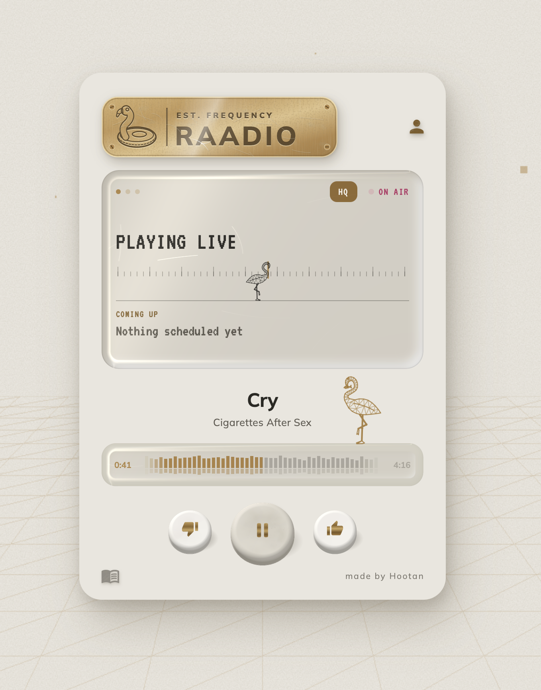
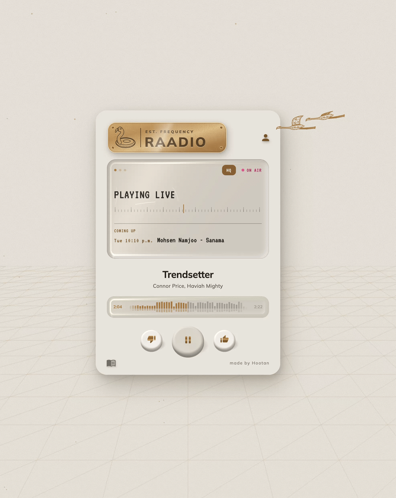
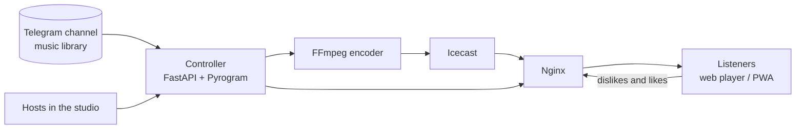

<div align="center">

# Raadio

**A self-hosted 24/7 internet radio where the listeners decide what stays on air.**

[](https://github.com/hootan-hsn/raadio-public/actions/workflows/ci-cd.yml)
[](LICENSE)


[**Try the demo**](https://hootan-hsn.github.io/raadio-public/) · [Listen at raadio.xyz](https://raadio.xyz) · English and Persian · installable as an app



</div>

One live station: everyone hears the same song at the same moment, and enough dislikes
move it along for everyone.

Raadio is a self-hosted internet radio station you run yourself. Songs come from a Telegram
channel you control, the controller lines them up and levels them, Icecast streams them to
everyone at once, and listeners dislike songs off — no streaming service in the middle, and no
account needed to listen.



## Features

- **Live streaming** in Opus (64k HQ, 32k Saver) and MP3 (128k), with quality switching and
  an automatic drop to Saver on weak connections
- **Clean sound:** every song is leveled to -14 LUFS (EBU R128) and otherwise left as uploaded
- **Dislikes and likes** with per-device and per-address limits: enough dislikes skip a song,
  and both move songs between tiers (star, 1, 0, -1, blocked)
- **Songs blend:** a song that ends on its own crossfades into the next over 5 s
- **Studio for hosts:** scheduled shows, uploads, and live shows with several hosts
- **Listener analytics:** busiest hours, people and session lengths per country, with no
  addresses stored
- **Installable PWA** in English and Persian, with a first-visit guide and light and dark themes
- **Relay script** for serving listeners through a second server under its own domain
- **Infrastructure as code:** Docker Compose, Nginx and Terraform on AWS
- **Your music, your server:** the library is a Telegram channel you control, and the whole
  station runs on one server you own
- **No build step, no framework in the player:** vanilla JavaScript, plain HTML audio, and a
  Three.js sky — open `web/` and it runs

## How it works



| Layer | Tools |
| --- | --- |
| Backend | Python, FastAPI, Pyrogram, SQLite |
| Audio | FFmpeg, Icecast, Opus, MP3 |
| Frontend | Vanilla JavaScript PWA, Three.js for the background sky |
| Delivery | Nginx, Certbot, Docker Compose |
| Cloud | Terraform, AWS EC2, CloudWatch alarms |
| Checks | GitHub Actions: Python, JavaScript, ShellCheck, Nginx, Docker, Terraform |

## Tiers, dislikes and song changes

Every song is in one of five tiers (`controller/rank.py`). Nothing in them is for good:

| Tier | How a song gets there | How often it plays |
| --- | --- | --- |
| ★ Star | Many recent likes, pinned in the channel, newly posted, or set by hand. **Lasts two weeks, then the song is tier 1.** | Every round, an extra turn, and the priority slot every few songs |
| 1 | Liked (rate at or below -0.08), or a star whose two weeks are up | Every round |
| 0 | Where every song starts | 60% of rounds |
| -1 | Disliked (rate 0.25 or more) | 25% of rounds |
| Blocked | Disliked a lot (rate 0.6 or more), or set by hand. **Stays blocked until someone changes it by hand.** | Never |

How listeners move a song: each dislike that skips it adds 1 to its net (less when the
disliker was alone, or when most of the song had played), each like takes off 1, each play to
the end takes off 0.1. Net and plays both fade by half every 30 days, so old opinions wear off
and a song can climb back. The tier comes from the rate, net / (plays + 8): a song with few
plays stays near 0, and a busy song isn't judged harder for collecting more votes. Each
listener counts once per song per day (kept hashed in `song_votes`, never as an address).
A song that moves starts a little inside its new tier, not on the edge, and stays at least
3 days before listeners can move it again; moving down also needs dislikes from 3 different
listeners. About five recent likes (each fading by half in three weeks) make a song a star.
Curators can put any song in any tier from the
studio's Rotation tile (`POST /api/curator/tracks/{id}` with `{"tier": "star" | 1 | 0 | -1 |
"blocked"}`); it then starts just inside that tier and stays a week before listeners can move it.

A dislike is the skip vote: enough of them and the song fades out and the next one starts. The
vote's reply says when (`lands_at`), and the player plays a tuning sound until then, the same
with the screen on or off, landing no sooner than 5 s after the press (`SKIP_LANDS_MS` in
`web/script.js`): measured 5.2 s to full volume in Chrome, Safari and Firefox alike. The player
feeds the stream in itself through Media Source, repackaging the Ogg Opus as WebM for Chrome and
Firefox (`OggToWebm`, no re-encoding), so it can land a skip as soon as it chooses. A song that ends on its own blends into the next: the last 5 s of one and the
first 5 s of the next are cut, and the two overlap for 5 s (`BLEND` in the controller; songs
under 30 s play whole).

## Flamingos

The flamingo is Raadio's bird. Now and then one flies in and lands on the radio; a listener who
taps it can leave a note of up to 55 letters (`controller/notes.py`). Every 150-360 s the station
picks a waiting note and a flamingo skywrites it across every listener's screen at once (`sky` in
`/now-playing`). A note lives 2 hours; once 7 are waiting the sky is full: notes last an hour,
new ones are refused and no flamingos come round until there's room. Each address can send one
note every 45 s and 8 an hour (counted in memory, never stored). Notes are checked against a
list of words that can't be printed (English, Finglish and Farsi, as whole words and as the
start of longer ones); studio users can edit, remove or add notes and words.

## Algorithms

- **Skip votes:** a dislike lasts 90 s (`VOTE_WINDOW`); 2 different listeners within that time
  skip the song (`SKIP_VOTES_NEEDED`), or one when Icecast says they're alone.
- **Tiers** (`controller/rank.py`): net and plays fade as `x · 0.5^(days / 30)`;
  `rate = net / (plays + 8)`; tier 1 at ≤ −0.08, −1 at ≥ 0.25, blocked at ≥ 0.6. After a move the
  song is rebased 0.05 inside its new tier and held 3 days (7 by hand). Listener keys are
  sha256 with a salt kept in the database, one vote per song per day, deleted after 30 days.
- **Loudness:** each file is measured once with FFmpeg's `ebur128` and played with a fixed gain
  to −14 LUFS, then a peak limiter. No EQ or compression, so songs sound as uploaded.
- **Blend:** the last and first 5 s are cut and overlapped with equal-power fades, so the level
  holds through the change.
- **In sync:** `/now-playing` carries the encoder's clock (`edge`, `clock`), so each player knows
  which moment it's hearing and turns `lands_at` into its own time.

## AWS

`infra/` is Terraform for one EC2 server: a security group with only 22, 80 and 443 open (the
app and Icecast stay on 127.0.0.1), an Elastic IP, a CloudWatch alarm that moves the server to
healthy hardware when AWS's status check fails, and an optional monthly budget alert by email.
The server is never rebuilt (`prevent_destroy`, AMI and user data ignored). State goes in a
private, versioned S3 bucket you create. CI only runs `terraform fmt` and `validate`; it never
touches your AWS account.

## Run it

Two ways in: just listen at [raadio.xyz](https://raadio.xyz) — nothing to install — or run
your own station with Docker (below).

You need Docker and [Telegram API credentials](https://my.telegram.org), plus a Telegram
channel you control that holds your music.

```bash
git clone https://github.com/hootan-hsn/raadio-public.git
cd raadio-public
cp .env.example .env          # then fill in your values
docker compose up -d --build
docker compose ps             # both should say "healthy" after about 30 s
```

The containers listen only on 127.0.0.1 (Icecast on 8000, API on 8080). Put Nginx in front of
them using the files in [`deploy/nginx`](deploy/nginx). Then point `CONFIG.HOSTS` in
`web/script.js` at your own domain, as it starts out pointing at raadio.xyz.

Login starts as a demo: any name and password open the studio, nothing leaves the browser and
nothing is saved. For real accounts, set `DEMO_LOGIN: false` in `web/script.js` and create users
with `controller/manage_users.py`.

Only play music you have the right to broadcast. Licensing depends on your country.

## Project layout

```
controller/   FastAPI app, Telegram client, FFmpeg encoder, studio and analytics
web/          The player (PWA), with no build step
deploy/       Nginx, Icecast and deployment scripts
infra/        Terraform for the AWS server, firewall and alerts
relay/        One-command relay server
```

## Contributing

See [CONTRIBUTING.md](CONTRIBUTING.md). To report a security problem, see
[SECURITY.md](SECURITY.md).

## This repo and raadio.xyz

This is the open core of Raadio. The station at raadio.xyz runs a private version with extra
playback and music-programming features that aren't included here.

## License

[AGPL-3.0](LICENSE). If you run a modified version as a service, you must publish your changes.

Built by [Hootan Hosseini](https://github.com/hootan-hsn) ·
[portfolio](https://hootan-hsn.framer.website/)
